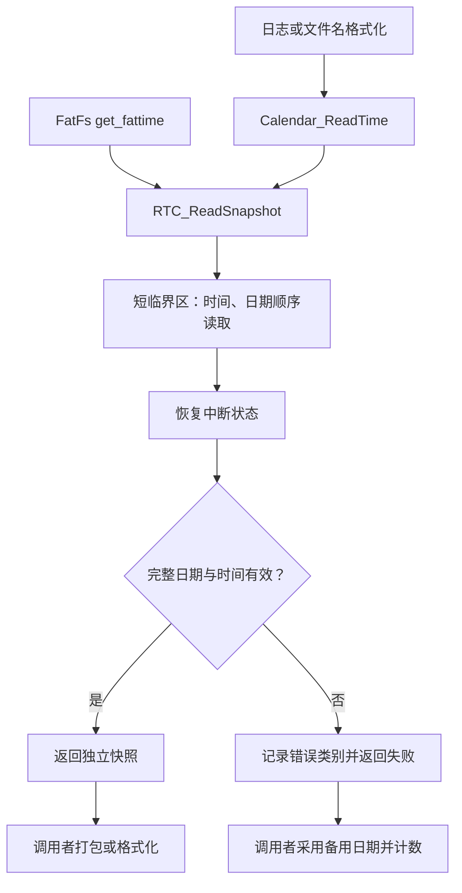

# RTC 快照与 FAT 时间戳完善

日志取时与文件时间戳统一调用 RTC_ReadSnapshot。使用局部 RTC 结构，在短 PRIMASK 临界区中依次调用 HAL_RTC_GetTime 和 HAL_RTC_GetDate，然后恢复进入前的中断状态。验证和 FAT 打包在临界区之外进行。

RTC_ReadSnapshot 校验年份 0～99（2000～2099）、月份、月份实际天数、公历闰年、小时 0～23、分秒 0～59。失败返回 0，保持调用者的输出结构不变；即使 HAL 读时间返回错误，仍读取日期以释放影子寄存器锁。

Calendar_ReadTime 输出调用者的独立日历快照，年份保持原来 2000 年偏移的语义。USB 日志加时间戳、记录模块 log.c 和文件名格式化都使用局部日历，不再逐字段读取共享 time。GetTime 作为兼容接口保留。

get_fattime 读取失败或校验失败时返回 2000-01-01 00:00:00，并增加专门计数；正常返回 FAT 打包时间，两秒精度保持不变。所有修改使用中文注释和 UTF-8；fatfs.c 的修改位于 CubeMX USER CODE 区。

## Watch

统一观察 g_rtc_read_diag：

| 字段 | 含义 |
|---|---|
| snapshot_calls / snapshot_ok | 读取请求 / 校验通过次数 |
| rtc_uninitialized | RTC 句柄未初始化 |
| read_error | HAL 返回失败 |
| invalid_date / invalid_time | 日期 / 时间字段不合法 |
| invalid_argument / rtc_disabled | 空指针参数 / 禁用 RTC |
| fattime_fallback_count | 文件时间戳使用备用日期的次数 |
| calendar_fallback_count | 日志/文件名使用备用日期的次数 |
| last_result | 最近一次结束的快照结果，0 为成功 |

last_result：0 成功，1 未初始化，2 HAL 读取失败，3 日期无效，4 时间无效，5 参数无效，6 RTC 禁用。计数仅保存在 RAM，复位后归零，不写 SD 或额外打印日志。

当前 HAL 取时实现正常路径固定返回 HAL_OK，不会直接判断 RTC 是否走时；字段校验与错误计数不能替代时钟源故障或 RTC 停走检测。

## 验证与备份

独立 V6.22 工程副本完整编译链接通过，0 错误、0 警告，原 V6.24 设置保留。原生 C 测试使用实际实现，覆盖 2000/2024/2096 闰日、非闰年 2 月 29 日、2 月 31 日、大小月、年月日与时分秒边界、HAL 失败仍读日期、IRQ 状态恢复、错误时输出不变、两类备用计数、跨午夜独立快照、兼容接口和诊断计数平衡，全部通过。

尚未烧录或实测跨午夜。修改前五个文件保存在 originals；make_test.py/run_test.cmd 用于本次实现测试。早期 diagnostics/test_fattime.py 是旧的单函数测试，本次请使用 rtc_snapshot 下的新测试。
